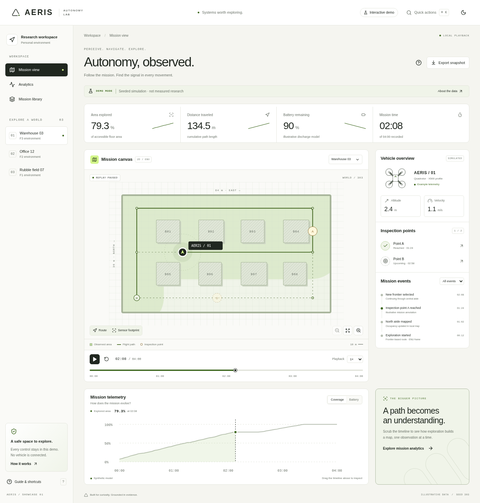

# AERIS — Autonomous Drone Intelligence Research Platform

**Perceive. Navigate. Explore. Decide.**

AERIS is a research platform for higher-level autonomy of a simulated
quadrotor: PX4 Autopilot handles flight control, Gazebo Harmonic handles
physics and sensors, and AERIS builds the layers above that — perception,
mapping, planning, learned exploration, mission execution, experiments,
replay, and a control-center UI.

The authoritative source of truth for what this project is, why, and how
it's built is **[`AERIS_TECHNICAL_SPEC.md`](AERIS_TECHNICAL_SPEC.md)**.
Read that before reading (or changing) anything else.

## Status

AERIS is built phase by phase (0–34), each with a written report and an
explicit validation gate — see `docs/phase_reports/`. Current status:

| Level | Capability                                        | Status                                                           |
| ----- | ------------------------------------------------- | ---------------------------------------------------------------- |
| —     | Architecture specified (Phase 0)                  | ✅ [phase-0.md](docs/phase_reports/phase-0.md)                   |
| —     | Mac / PX4 / Gazebo compatibility proven (Phase 1) | ✅ [phase-1.md](docs/phase_reports/phase-1.md)                   |
| —     | Python research runtime through Phase 14          | See [phase reports](docs/phase_reports/) for validation evidence |
| —     | Portfolio web showcase                            | Interactive synthetic demo in [`frontend/`](frontend/)           |
| —     | Connected Control Center / server                 | Still planned; no live API implemented                           |

The research runtime includes vehicle/safety, mapping, exploration, FastSim and PPO.
Read each phase report for the exact validated capabilities and limitations;
the portfolio showcase is illustrative and does not add autonomy claims.

## Interactive portfolio showcase



The standalone **Next.js + TypeScript + Motion** experience in [`frontend/`](frontend/README.md) offers seeded mission playback, linked map/telemetry/events, analytics, themes, command palette and JSON export. It runs without Python, PX4, credentials or a backend. All displayed mission data is explicitly synthetic.

```bash
cd frontend
npm ci
npm run dev
```

See the [showcase README](frontend/README.md) for screenshots, production commands, an architecture diagram, embedding instructions and fixture regeneration; [QA evidence](frontend/QA.md), [audit](AUDIT.md), [research](RESEARCH.md) and [decisions](DECISIONS.md) cover scope and limitations. The existing Python development commands below remain available.

## Repository layout

See spec §14 for the full rationale. In short:

- `aeris/` — the core Python package (created incrementally; see each
  module's docstring for which phase added it).
- `backend/`, `frontend/` — the control-center API and UI (Phase 25+).
- `configs/` — versioned configuration, including the frozen
  `configs/versions.lock.yaml` from the Phase 1 compatibility spike.
- `docs/` — architecture notes, ADRs, phase reports, and (once they exist)
  the setup/PX4/perception/etc. reference docs listed in spec §57.1.
- `third_party/patches/px4/` — the minimal, documented PX4 build-system
  patches needed to compile PX4 v1.17.0 on this class of Mac (see its
  `README.md`).
- `tests/` — `unit/`, and later `sim/`, `integration/`, `eval/`,
  `backend/` as those layers come online (spec §44.1).

PX4 itself is an **external, pinned dependency** (spec §8.3, ADR-002) — it
lives outside this repo, by default at `~/aeris-deps/PX4-Autopilot`, not
inside it.

## Quick start

This project's Mac setup is non-trivial — see
**[`docs/mac-setup.md`](docs/mac-setup.md)** for the exact, tested sequence
(Homebrew, PX4, Gazebo Harmonic, the patches, and several package-version
gotchas found in Phase 1).

Once that's done, for AERIS's own Python package:

```bash
uv sync --extra dev
uv run pytest
uv run ruff check .
uv run mypy aeris
uv run python -m importlinter lint
```

Or via the `Makefile`:

```bash
make setup   # uv sync --extra dev
make test    # pytest
make lint    # ruff + mypy + import-linter
```

## Engineering principles (see spec §59 for the full list)

Correctness before complexity. Safety before learned control. Simulation
before physical deployment (**physical flight is explicitly out of scope
— see spec §3.2**). Baselines before claims. Evidence before conclusions.
No fabricated metrics, plots, or results, ever (spec §57, "No fake
success").
