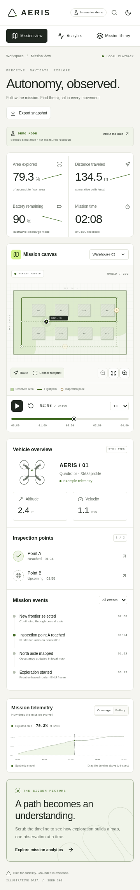
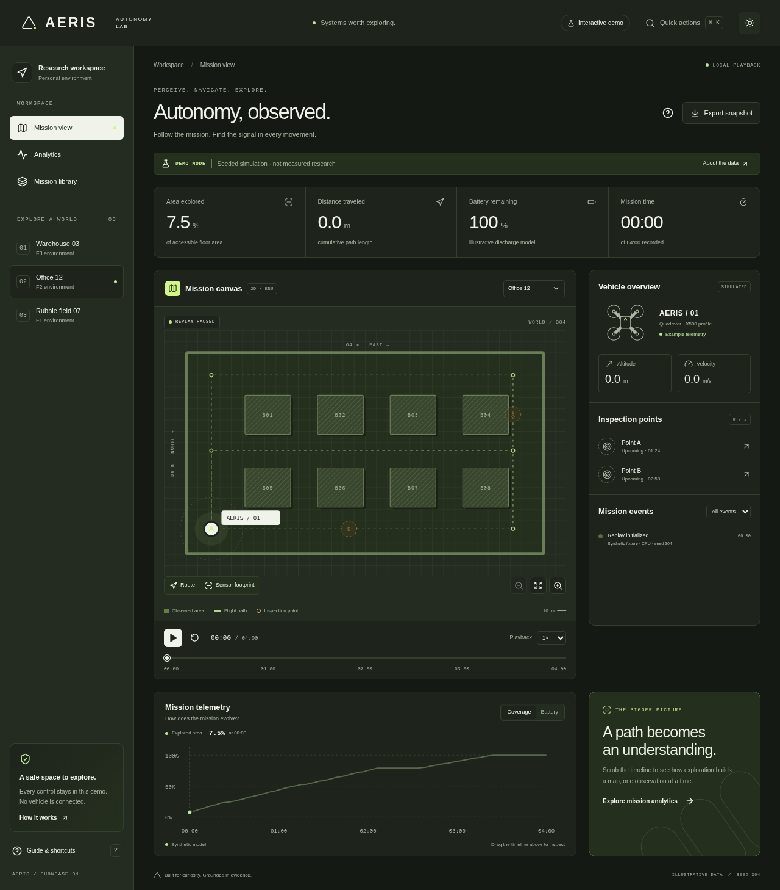
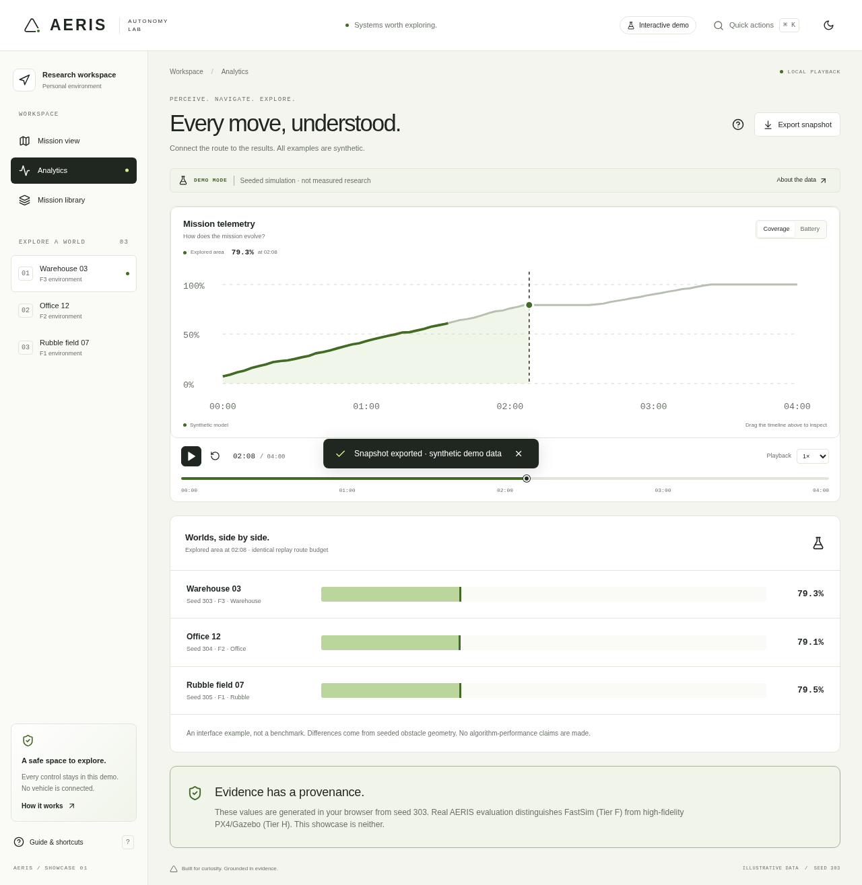
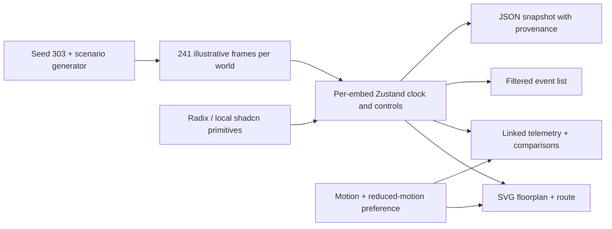

# AERIS showcase — autonomy, observed

A self-contained, interactive mission replay for a Next.js portfolio. Three seeded worlds, one synchronized clock, and no backend or vehicle connection.


| Mobile                                                          | Night mode                                         |
| --------------------------------------------------------------- | -------------------------------------------------- |
|  |  |



## Run

Node 22+ (tested on Node 24.19.0), npm and a modern browser. From this directory:

```bash
npm ci
npm run dev
```

Production: `npm run build && npm start`. Default port: 3000. No secrets, external fonts, tile services or Python packages are needed by the showcase.

Demo is enabled by default. Set `NEXT_PUBLIC_DEMO_MODE=true` explicitly in your portfolio build if desired. `NEXT_PUBLIC_DEMO_MODE=false npm run build` produces an honest disconnected state; it does not invent a server integration. This flag is read at build time, so rebuild after changing it.

## Try it

- Choose a world; play/pause, change speed, or drag/key through the native timeline slider.
- The route, explored area, metrics, events and telemetry all share one clock.
- Toggle route/sensor layers, zoom the map, or jump to an inspection event.
- Compare coverage at the same timestamp in Analytics, with its own linked timeline.
- Filter events; search the mission library; export a JSON snapshot with explicit synthetic provenance.
- Cmd/Ctrl+K opens a searchable command palette. Space plays/pauses; arrows seek ±10 seconds; `?` opens the guide. Inputs, dialogs and focused buttons retain their native keyboard behavior.
- Switch day/night themes. System reduced-motion preference disables transforms, scan animation, count-up interpolation and CSS animations. The clock still updates because playback is content, not ornamental motion.

## Embed in a portfolio

Copy **only** `src/modules/aeris/` into your existing Next.js App Router project. This folder uses relative internal imports, CSS Modules and no Next-specific API. It owns its tokens, fonts, styles, dialogs and per-instance Zustand store. There is no global reset or global state. Dialog portals are scoped by the same CSS Module and theme tokens.

Install the corresponding dependencies from this package: React, Motion, Zustand, lucide-react, Radix Dialog/Slot, cmdk, class-variance-authority and clsx. Tailwind v4 is configured in the demo host without Preflight; the module does not need your global Tailwind stylesheet. Local shadcn-style Button/Dialog primitives are in `ui/`; `components.json` records the local convention.

```tsx
// app/projects/aeris/page.tsx — adapt this path to where you copy the folder
import { AerisShowcase } from "@/modules/aeris";
export default function AerisPortfolioPage() {
  return <AerisShowcase demo={process.env.NEXT_PUBLIC_DEMO_MODE !== "false"} />;
}
```

The module fills its containing route and uses viewport breakpoints at 650/950/1150px. For a narrow embedded card on a wide page, place it in its own route or iframe; container-query layouts are not implemented. It renders an `h1` and `main`, so prefer a standalone portfolio route. Change `--bg`, `--surface`, `--ink`, `--accent`, `--green`, `--font`, `--mono`, `--radius` and spacing/motion tokens in `showcase.module.css` to retheme. Supported light/dark themes have separate contrast-tested tokens. Multiple stores are isolated; a host with its own global command palette should arbitrate Cmd/Ctrl+K before this module using `preventDefault()`.

## Data and architecture



The command palette and guide are lazy-loaded on opening. Motion layout/animation features load on the first pointer/key interaction; the initial screen is server-rendered and usable without them. System fonts and inline SVG avoid font/image downloads.

`data.ts` defines the deterministic model, `store.tsx` owns playback state, `showcase.tsx` composes the experience, `boundary.tsx` provides render recovery and `ui/` contains locally owned primitives. The host `app/` only supplies metadata, Tailwind configuration, a loading shell and the build flag.

Regenerate the inspectable static fixture with `npm run demo:generate`; this writes `public/demo/seed-303.json`. Change the default seed in `makeScenarios` to create another deterministic set and regenerate. The UI computes frames from the same generator in memory; the JSON is an inspectable export, not a second fetched data source. Tests assert deterministic regeneration, finite/bounded telemetry, obstacle-free routes, synchronized inspection coordinates, clock behavior and no future events in snapshots.

All telemetry is **synthetic demonstration data**, not a real FastSim or PX4 run. Map coordinates are local ENU, ten drawing units per meter. Coverage is the proportion of free 2 m grid cells visited within an illustrative 8.3 m sensing radius (no occlusion model). Path length sums ENU displacements; velocity comes from adjacent samples; battery is a distance-based illustrative discharge. Annotation points are synchronized with route coordinates. There is no target detector, live video or scientific-performance claim. The map footprint approximates radial cell coverage with a continuous stroke, so its visual area is not a separate coverage calculation.

## Validate

```bash
npm run lint
npm run typecheck
npm test
npm run build
npm start
# In another terminal, with system Chromium installed:
CHROME_PATH=/usr/bin/chromium npm run test:e2e
```

Playwright tests run on the production server, capture screenshots at 360/768/1440px, exercise playback/filter/search/export/themes/keyboard, assert zero browser errors and audit WCAG A/AA with axe. Final mobile Lighthouse: **94 performance / 100 accessibility / 100 best practices / 100 SEO**. All **7 browser tests** pass after the final production audit. See [QA.md](QA.md) for exact evidence and limits. Screenshots are generated by the tests; no screenshots are presented as actual flight evidence.

## Remaining project work

No backend logic or API contract was changed. The Python research runtime is still the source of truth for real evaluation. Live APIs, authenticated commands, MCAP export adapter, sensor images, full Control Center and higher research roadmap phases remain separate work. No deployed portfolio URL or real vehicle service was supplied; this task prepares a buildable module, not a production flight console. See [audit](../AUDIT.md), [research](../RESEARCH.md) and [decisions](../DECISIONS.md).
